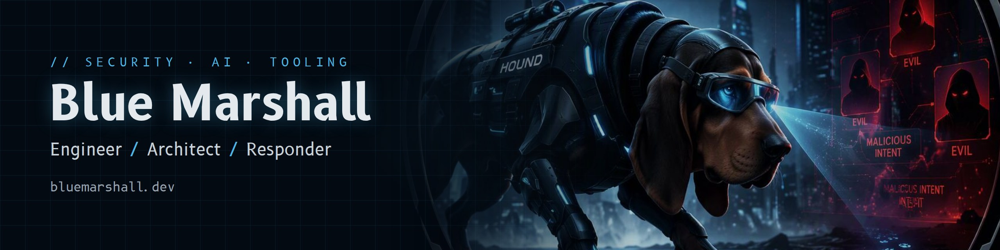

  

  
  
  

## About

Security engineer, architect and incident responder. A fire marshal sets the rules, inspects the build
and takes charge at the scene. I try to do the same three jobs for security, and the name comes from it.

- Local AI and agents for security work, on hardware I own.
- AI security: maturity, visibility, and the controls that hold up.
- Detection engineering and threat hunting across more than one platform.
- Incident response: what worked, what didn't, and what I'd change.

## Tech stack

  

  
  
  
  
  
  

## Projects

| Repository | What it is | Write-up |
|---|---|---|
| [hound](https://github.com/blu3marshall/hound) | A read-only SOC agent harness. Ask a question in plain language; it hunts across your security platforms and writes a report with the evidence. Runs on your own infrastructure, with a hosted model or a local one | [Architecture](https://bluemarshall.dev/posts/hound-agent-harness-architecture/) |
| [ai-visibility-map](https://github.com/blu3marshall/ai-visibility-map) | A coverage map for the AI running in a company: five AI asset classes across four environments, each cell scored by the tool that can see it. Excel, Markdown and HTML | [Which tool can see your AI?](https://bluemarshall.dev/posts/ai-visibility-which-tool-can-see-your-ai/) |
| [family-planner](https://github.com/blu3marshall/family-planner) | A small family planner for the home network: calendar, school email digest, and grades from a PowerSchool parent portal. Ships with a fictional family and a demo mode | [A home app for the family](https://bluemarshall.dev/posts/home-app-family-planner-powerschool/) |
| [local-kids-agent](https://github.com/blu3marshall/local-kids-agent) | A chat agent for children on the home network, with a separate desk for parents. README and screenshots only; the code is not published yet | [A home app for the family](https://bluemarshall.dev/posts/home-app-family-planner-powerschool/) |

## Latest posts

<!-- BLOG-POST-LIST:START -->
- [A 125B model on a DDR4 desktop](https://bluemarshall.dev/posts/125b-model-on-a-ddr4-desktop/)
- [AI security maturity: find your stage, then take the next step](https://bluemarshall.dev/posts/ai-security-maturity-find-your-stage/)
- [AI visibility: which tool can actually see your AI?](https://bluemarshall.dev/posts/ai-visibility-which-tool-can-see-your-ai/)
- [hound: the architecture of a read-only SOC agent](https://bluemarshall.dev/posts/hound-agent-harness-architecture/)
- [A home app for the family: calendar, school mail and PowerSchool grades on one page](https://bluemarshall.dev/posts/home-app-family-planner-powerschool/)
<!-- BLOG-POST-LIST:END -->

## Activity

  
  

<!-- Snake: switched on once .github/workflows/profile.yml is in the repo and has run once.

  <picture>
    <source media="(prefers-color-scheme: dark)" srcset="https://raw.githubusercontent.com/blu3marshall/blu3marshall/output/snake-dark.svg">
    
  </picture>

-->

<!-- Trophies, from the video. Left off until the account has a few months of history:

  

-->

Example companies in these projects are fictional. They are personal projects, shared as they are.
